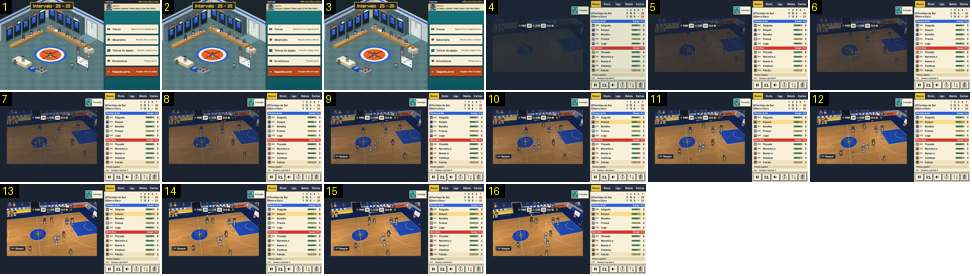

# Intervalo: regresso ao campo

Depois de «Segunda parte», o balneário corta para o campo escuro, que clareia em 1 s com o jogo já a correr. Compara-se com a segunda metade de [intervalo-balneario-e-regresso](../../../../calciobit/sequencias/entrada-saida/intervalo-balneario-e-regresso/README.md).

- **Duração:** 1,6 s, 16 frames a 10 fps
- **Origem:** `npm run sequences` (commit 2de1e62), vídeo `jogo-fim.mp4`, de 36,2 s a 37,8 s
- **Etiquetas:** intervalo, balneario, segunda-parte, corte, fundido-escuro, camara
- **Calciobit:** [intervalo-balneario-e-regresso](../../../../calciobit/sequencias/entrada-saida/intervalo-balneario-e-regresso/README.md)

## Frame a frame

- **1–3:** o balneário do intervalo, parado. O toque em «Segunda parte» cai entre o 3 e o 4 (o vídeo salta 0,12 s). O botão não muda de cor de forma visível.
- **4 (36,5 s):** corte seco do balneário para o campo, muito escuro, com azul-escuro por cima. O painel do jogo já está aceso, com «Começa o período 3» nas últimas jogadas e o relógio a «P3 2:00». Os jogadores já estão espalhados no meio-campo, sem bola ao alto: no basquetebol a posse alterna.
- **4–13 (1,0 s):** o campo clareia de forma linear. Por baixo do escuro o jogo já corre: a câmara diagonal anda e os jogadores mexem-se.
- **13–16:** a imagem normal. A etiqueta «ESC Gaspar» aparece em baixo à esquerda e o relógio de posse no marcador.
- **Notas:** não há preto, nem plano de recomeço, nem faixa «Período 3». O regresso leva 1,0 s, contra 1,4 s no Calciobit (0,3 + 0,2 + 0,9 s).
