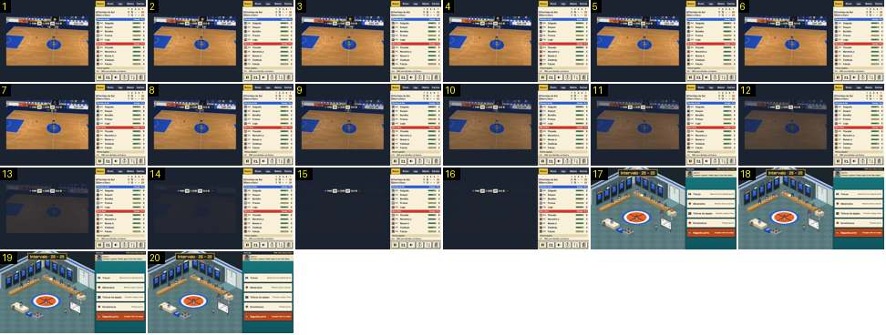

# Intervalo: do campo ao balneário

O fim do 2.º período leva ao balneário. Depois de os jogadores saírem, o campo escurece para azul-escuro com o marcador por cima, e abre-se o balneário com o resultado ao intervalo. Compara-se com a primeira metade de [intervalo-balneario-e-regresso](../../../../calciobit/sequencias/entrada-saida/intervalo-balneario-e-regresso/README.md).

- **Duração:** 2,0 s, 20 frames a 10 fps
- **Origem:** `npm run sequences` (commit 2de1e62), vídeo `jogo-fim.mp4`, de 32,0 s a 34,0 s
- **Etiquetas:** intervalo, balneario, fundido-escuro, marcador, isometrico, ui
- **Calciobit:** [intervalo-balneario-e-regresso](../../../../calciobit/sequencias/entrada-saida/intervalo-balneario-e-regresso/README.md)

## Frame a frame

- **Antes (26,0–32,0 s):** com o relógio a «P2 0:00», a faixa «Fim do período 2» aparece ao centro (≈ 1,5 s). Os jogadores andam a passo para os bancos, em cima, e a câmara segue-os no plano diagonal, sem zoom. Ao fim de ≈ 4 s o campo está quase vazio, só com o árbitro e a bola parada.
- **1–7:** o campo vazio, com o árbitro no círculo central e o marcador «MAR 26 · P2 0:00 · 20 CLA».
- **8–15 (0,8 s):** o campo escurece de forma linear para azul-escuro, o mesmo tom do fundo da página. O marcador fica por cima, sempre aceso. O painel da direita não muda.
- **15–16:** só o marcador sobre o azul-escuro (0,2 s).
- **17:** o balneário aparece já aceso. A cortina `stage-in` de 0,18 s cai num salto de 0,2 s sem imagens no vídeo. É o mesmo balneário de antes do jogo, com a equipa espalhada, e em cima à esquerda há uma caixa escura com contorno dourado: «Intervalo · 26 – 20». No painel: «Intervalo · MAR contra Barra Clara», o adjunto («Estamos a ganhar. Mudar agora é dar-lhes ideias.»), Trocas, Adversário, Táticas da equipa, Estatísticas (primeira parte) e o botão laranja «Segunda parte · A equipa volta ao campo».
- **17–20:** parado. Não há contagem visível. Se ninguém tocar, a 2.ª parte começa sozinha ao fim de 30 s, e cada toque volta a contar os 30 s.
- **Medidas:** do fim do período ao início do escurecimento ≈ 6,7 s; escurecer 0,8 s; azul-escuro 0,2 s; abrir 0,18 s.
