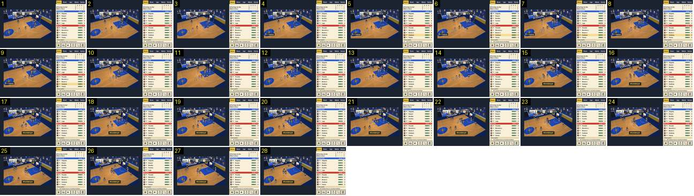

# Ressalto e afundanço: a câmara não reage ao cesto

Um lançamento de três falhado, o ressalto ofensivo e o afundanço do Barra Clara, vistos pela câmara de jogo. O cesto não tem corte, zoom nem paragem: aparecem o «+2», a palavra «Afundanço!» e o balão de um adepto, e a câmara começa logo a deslizar para o outro lado. Compara-se com o grande plano parado do [pontape-de-saida-corte-e-zoom-out](../../../../calciobit/sequencias/jogo-camara/pontape-de-saida-corte-e-zoom-out/README.md) e com a câmara larga e fixa do golo no Calciobit (`camara-e-estilo.md`, «Câmara no golo»).

- **Duração:** 2,8 s, 28 frames a 10 fps
- **Origem:** `npm run sequences` (commit 2de1e62), vídeo `jogo.mp4`, de 42,4 s a 45,2 s
- **Etiquetas:** camara, cesto, afundanco, ressalto, seguimento, sem-corte
- **Calciobit:** [pontape-de-saida-corte-e-zoom-out](../../../../calciobit/sequencias/jogo-camara/pontape-de-saida-corte-e-zoom-out/README.md), [plano-largo-para-diagonal](../../../../calciobit/sequencias/jogo-camara/plano-largo-para-diagonal/README.md)

## Frame a frame

- **1–7:** plano diagonal do cesto da direita, parado. Os dez jogadores estão à volta do garrafão; o balão de um adepto («ISS…») está colado ao marcador, à esquerda. O painel diz «CLA: Noronha falha o lançamento de 3».
- **8:** etiqueta «EXP Zambujo» em baixo à esquerda: o ressalto ofensivo.
- **8–13:** Zambujo sobe para o cesto, debaixo da tabela. A câmara continua parada.
- **14:** o cesto. O marcador passa de 2 para 4 no CLA.
- **15:** «+2» amarelo junto à tabela e a palavra «Afundanço!» em amarelo, numa caixa escura, em baixo ao centro do campo. Entram de uma vez, sem animação de escala.
- **15–20:** os jogadores voltam para trás e a câmara começa a deslizar e a rodar, a seguir a bola que o Marítimo vai repor: o cesto passa de x ≈ 268 para ≈ 290 no ecrã de 640.
- **21–28:** continua o deslize, devagar. O balão do adepto muda para «ISTO É…». O «+2» e «Afundanço!» ficam no ecrã até ao fim do troço (1,4 s ou mais). O relógio nunca parou (1:24 → 1:22).
- **O que não acontece:** não há corte, zoom, abanão, abrandamento nem repetição do cesto. O mesmo vê-se nos movimentos especiais: o crossover (`jogo.mp4`, 46,6 s) e o «Afundanço de Força!» (52,0 s) aparecem só com o nome em baixo e a câmara de sempre.
