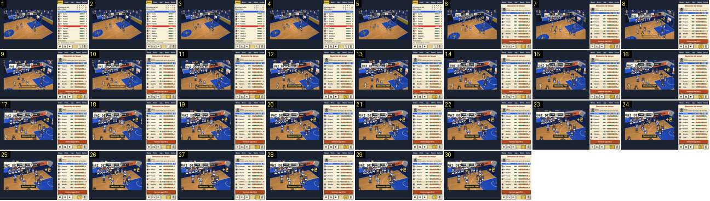

# Desconto de tempo: zoom contínuo para o banco

O treinador pediu um desconto; ao primeiro cesto, o jogo para e a imagem aproxima-se do banco da casa até ao dobro, sem corte, enquanto a câmara desce e vai para a esquerda. É o único grande plano do jogo corrido no Pocket Basketball. Compara-se com a entrada dos grandes planos do Calciobit ([cartao-vermelho-corte](../../../../calciobit/sequencias/jogo-camara/cartao-vermelho-corte/README.md)), que corta, e com o zoom contínuo do [canto](../../../../calciobit/sequencias/jogo-camara/canto-grande-plano-e-cruzamento/README.md).

- **Duração:** 1,0 s, 30 frames a 30 fps
- **Origem:** `npm run sequences` (commit 2de1e62), vídeo `paragens.mp4`, de 32,6 s a 33,6 s
- **Etiquetas:** camara, desconto, zoom, grande-plano, banco, sem-corte
- **Calciobit:** [cartao-vermelho-corte](../../../../calciobit/sequencias/jogo-camara/cartao-vermelho-corte/README.md), [canto-grande-plano-e-cruzamento](../../../../calciobit/sequencias/jogo-camara/canto-grande-plano-e-cruzamento/README.md), [sorteio-zoom-e-fade](../../../../calciobit/sequencias/jogo-camara/sorteio-zoom-e-fade/README.md)

## Frame a frame

- **1–5:** plano diagonal do cesto da direita, com o jogo a correr. O marcador está em «MAR 22 P2 0:23 16 CLA».
- **6:** o cesto do Barra Clara (16 → 18), «+2» junto à tabela, e no mesmo frame começa o zoom: a imagem já está cerca de 1,3 vezes maior e a câmara foi para a esquerda e desceu (o círculo central sai pelo canto inferior esquerdo). Por cima do marcador aparece o balão de um adepto, «VAI DESCANSAR».
- **7–12:** o zoom continua e abranda (~1,45×, ~1,6×, ~1,75×…). Em baixo, a meio, entra «Desconto: MAR» em amarelo numa caixa escura, por fade, em ~0,2 s (frames 8–12).
- **12–30:** a aproximação abranda até quase parar no dobro. O banco do Marítimo enche o topo da imagem, com os suplentes de pé, e os cinco do campo começam a andar para lá. O cesto sai pela direita perto do frame 19 e o garrafão fica no canto inferior direito.
- **Em todo o troço:** é a imagem toda que cresce, por isso os píxeis ficam com o dobro do tamanho (sem suavização). O marcador e o balão do adepto não crescem: estão por cima da imagem. O relógio está parado em 0:23.
- **Depois do troço (não incluído):** o plano fica parado no banco até ao fim da gravação (46 s), com a roda de jogadores e o painel do desconto a contar «Continuar jogo (30 s)». A saída (o zoom de volta quando o jogo recomeça) não foi gravada. No código, a entrada e a saída usam a mesma curva, 1 − e^(−4t): 63 % do caminho em 0,25 s e 95 % em 0,75 s (`render` em `src/ui/match-view.ts`).
