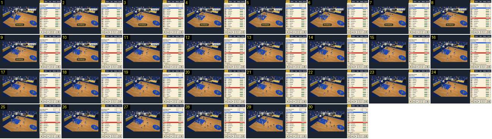

# Falta e lance livre: tudo no plano de jogo

Um afundanço com falta, os jogadores a alinharem no garrafão e o lance livre adicional, que entra. A câmara fica no plano de jogo do princípio ao fim: não há grande plano da falta nem do lançador. É o par, no basquetebol, dos [cartões](../../../../calciobit/sequencias/jogo-camara/cartao-amarelo-zoom-e-saida/README.md) e dos [penáltis](../../../../calciobit/sequencias/jogo-camara/penaltis-remate-camara-fixa/README.md) do Calciobit.

- **Duração:** 6,0 s, 30 frames a 5 fps (a câmara quase não se mexe, por isso chega meio ritmo)
- **Origem:** `npm run sequences` (commit 2de1e62), vídeo `paragens.mp4`, de 13,3 s a 19,3 s
- **Etiquetas:** camara, falta, lance-livre, plano-fixo, sem-corte, marcador
- **Calciobit:** [cartao-amarelo-zoom-e-saida](../../../../calciobit/sequencias/jogo-camara/cartao-amarelo-zoom-e-saida/README.md), [cartao-vermelho-corte](../../../../calciobit/sequencias/jogo-camara/cartao-vermelho-corte/README.md), [penaltis-remate-camara-fixa](../../../../calciobit/sequencias/jogo-camara/penaltis-remate-camara-fixa/README.md)

## Frame a frame

- **1–2:** o afundanço do Marítimo no cesto da esquerda: «+2» junto à tabela, «Afundanço!» em baixo e o balão de um adepto («…PASSE? IA…») à direita do marcador. Por cima do jogador que sofreu a falta flutua «FALTA», em amarelo com contorno escuro, à altura da cabeça.
- **1–4:** a câmara ainda assenta depois do salto da gravação: desliza um pouco e para.
- **3–8:** «FALTA» sobe devagar e fica por cima do grupo. Os jogadores andam para os lugares do lance livre.
- **9–10:** «FALTA» desaparece, cerca de 1,6 s depois de aparecer. «Afundanço!» fica até ao frame 12.
- **11–26 (3,2 s):** plano fixo do lance livre: o lançador na linha, três jogadores de cada lado do garrafão e os outros atrás. O relógio está parado em 1:20. Não há etiqueta de nome do lançador, não há faixa e a câmara não se mexe.
- **27:** o lance livre entra: o marcador passa de 15 para 16 e aparece «+1» amarelo junto à tabela. O marcador acende-se com uma faixa branca por cima (frames 27–30).
- **28–30:** os jogadores voltam a correr e a câmara começa a deslizar para a direita, atrás da bola. O relógio volta a andar (1:19).
- **Em todo o troço:** o zoom é o do jogo e não há corte nem preto. O árbitro anda entre os jogadores, sem gesto próprio.
