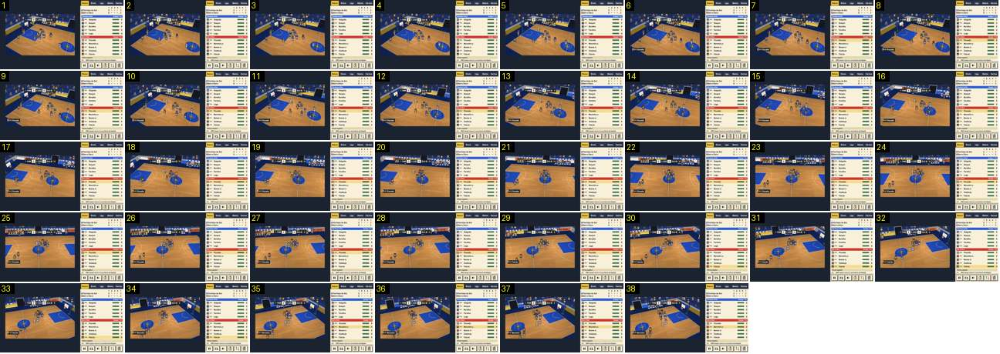

# Mudança de lado: a câmara desliza e roda de um cesto ao outro

Depois de um cesto do Marítimo, o Barra Clara sobe com a bola e a câmara atravessa o campo inteiro: sai do plano diagonal do cesto da esquerda, passa pelo plano de frente a meio campo e acaba no plano diagonal do cesto da direita, sempre sem corte e sem zoom. Compara-se com [plano-largo-para-diagonal](../../../../calciobit/sequencias/jogo-camara/plano-largo-para-diagonal/README.md), que faz metade deste caminho, e muito mais devagar.

- **Duração:** 3,8 s, 38 frames a 10 fps
- **Origem:** `npm run sequences` (commit 2de1e62), vídeo `jogo.mp4`, de 19,8 s a 23,6 s
- **Etiquetas:** camara, seguimento, pan, rotacao, plano-diagonal, plano-de-frente, mudanca-de-lado
- **Calciobit:** [plano-largo-para-diagonal](../../../../calciobit/sequencias/jogo-camara/plano-largo-para-diagonal/README.md)

O campo de jogo ocupa só a parte esquerda do ecrã, cerca de 361×216 px dos 640×360 da sequência (de x 27 a 388); à direita está o painel. As medidas abaixo são nesse ecrã de 640.

## Frame a frame

- **1–6:** plano diagonal do cesto da esquerda, logo depois do cesto: «+2» amarelo junto à tabela, o marcador «MAR 2 P1 1:54 0 CLA» por cima do campo. A bancada do fundo sobe na diagonal para a direita, e no canto superior direito vê-se a esquina da bancada do topo, amarela. A câmara quase não anda: o círculo central passa de x ≈ 340 para ≈ 330.
- **7:** em baixo à esquerda aparece a etiqueta de quem tem a bola («BAS Macedo»), que fica até ao fim do troço e troca de nome no frame 31 («POS Falcão») e no 37 («ESC Noronha»).
- **7–12:** a câmara arranca para a direita, atrás da bola, e a imagem começa a rodar: a linha lateral de cima fica menos inclinada. O círculo central vai de x ≈ 330 para ≈ 310 (cerca de 40 px/s).
- **12–22:** o troço mais rápido. O círculo central vai de x ≈ 310 para ≈ 225 (~85 px/s, cerca de um quarto da largura do campo visível por segundo). A rotação continua: no frame 22 a câmara está de frente, com a linha do meio quase vertical, a bancada numa faixa horizontal no topo e os dois garrafões a sair pelas bordas.
- **22–33:** a rotação passa para o outro lado. A bancada passa a subir para a esquerda, aparece o túnel preto no canto superior esquerdo e o cesto da direita entra pelo canto superior direito (frame 31). O círculo central vai de ≈ 225 para ≈ 125 (~90 px/s).
- **33–38:** plano diagonal do cesto da direita, espelho do frame 1. A câmara ainda anda (o círculo vai de ≈ 125 para ≈ 85) e abranda pouco: segue a bola, que o Barra Clara leva até ao garrafão.
- **Em todo o troço:** o tamanho dos bonecos não muda (não há zoom) e não há corte. O marcador fica sempre ao centro em cima, por cima do campo, e o relógio corre (1:54 → 1:50). A câmara olha 3 m à frente da bola, para o lado do cesto atacado, e a rotação está presa à posição da câmara: quanto mais perto de um cesto, mais diagonal (`cameraTarget` em `src/ui/match-view.ts` e `Camera.aim` em `src/ui/art/court.ts`).
