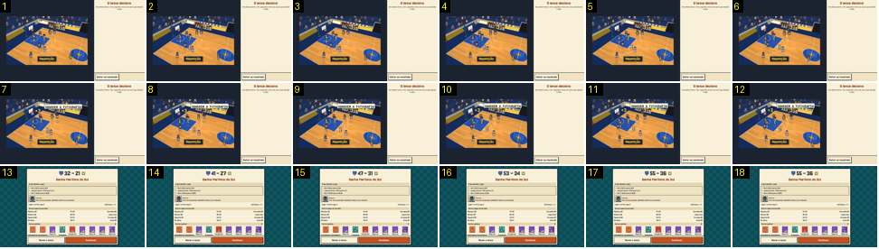

# Repetição: o triplo e a saída por corte

O fim da repetição do lance decisivo: o triplo entra, aparece «+3», e o toque em «Voltar ao resultado» corta logo para o relatório, onde o resultado volta a contar de baixo. Compara-se com [repeticao-golo-saida](../../../../calciobit/sequencias/jogo-camara/repeticao-golo-saida/README.md), que sai pelo preto.

- **Duração:** 1,8 s, 18 frames a 10 fps
- **Origem:** `npm run sequences` (commit 2de1e62), vídeo `jogo-fim.mp4`, de 56,9 s a 58,7 s
- **Etiquetas:** camara, repeticao, cesto, corte, camara-lenta, relatorio, contagem
- **Calciobit:** [repeticao-golo-saida](../../../../calciobit/sequencias/jogo-camara/repeticao-golo-saida/README.md)

## Frame a frame

- **1–6:** a repetição em câmara lenta, no plano diagonal do cesto da esquerda. O lançador sobe para o triplo; a câmara está quase parada. «Repetição» continua fixa em baixo.
- **7:** a bola entra: «+3» amarelo junto à tabela e o balão de um adepto, «GUARDEM A FOTOGRAFIA», por cima do campo. Não há marcador para mudar, porque a repetição não o mostra.
- **7–12:** os jogadores começam a recuar, devagar. A câmara não muda.
- **13:** corte seco para o relatório, sem preto nem fade: é o toque em «Voltar ao resultado», 0,6 s depois do cesto. O resultado no topo do cartão recomeça a contar: «32 – 21».
- **14–17:** o resultado sobe, «41 – 27», «47 – 31», «53 – 34», até «55 – 36» no frame 17 (~0,4 s). O resto do cartão não se mexe.
- **A repetição inteira:** de 51,8 s a 58,0 s, cerca de 6,2 s, e o cesto só chega nos últimos 0,6 s. Sem o toque, a repetição acabava sozinha 1,5 s de jogo (3 s reais) depois do cesto (`startReplay` em `src/ui/main.ts`).
