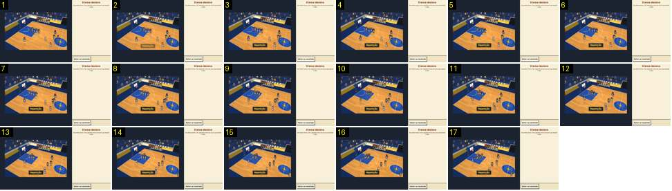

# Repetição: entrada por corte seco

O toque em «Rever o lance» no relatório. O cartão do resultado desaparece de uma vez e o campo volta, já a correr em câmara lenta, com a câmara de jogo e a palavra «Repetição» em baixo. Compara-se com a entrada pelo preto das repetições do Calciobit ([fora-de-jogo-fiscal-e-linha](../../../../calciobit/sequencias/jogo-camara/fora-de-jogo-fiscal-e-linha/README.md)).

- **Duração:** 1,7 s, 17 frames a 10 fps
- **Origem:** `npm run sequences` (commit 2de1e62), vídeo `jogo-fim.mp4`, de 51,8 s a 53,5 s
- **Etiquetas:** camara, repeticao, corte, camara-lenta, faixa
- **Calciobit:** [fora-de-jogo-fiscal-e-linha](../../../../calciobit/sequencias/jogo-camara/fora-de-jogo-fiscal-e-linha/README.md), [repeticao-golo-saida](../../../../calciobit/sequencias/jogo-camara/repeticao-golo-saida/README.md)

## Frame a frame

- **Antes do frame 1:** o relatório do jogo, um cartão creme sobre fundo verde com «55 – 36», «Rever o lance» e «Continuar». O vídeo não tem imagens entre 49,1 s e 51,8 s porque o ecrã não mudou; a imagem seguinte já é o frame 1, por isso a passagem é um corte seco, sem preto nem fade.
- **1:** o campo, no plano diagonal do cesto da esquerda, com os jogadores à volta do garrafão. Não há marcador, relógio nem a barra de botões. À direita, o painel diz «O lance decisivo» e «Em câmara lenta, três segundos antes do cesto que decidiu o jogo.», com o botão «Voltar ao resultado» em baixo.
- **2–3:** «Repetição» em amarelo numa caixa escura entra em baixo ao centro por fade (~0,2 s) e fica fixa, sem piscar.
- **3–17:** o jogo corre a metade da velocidade: os jogadores mexem-se devagar e a câmara segue a bola com a mesma regra do jogo, quase parada. Não há zoom.
