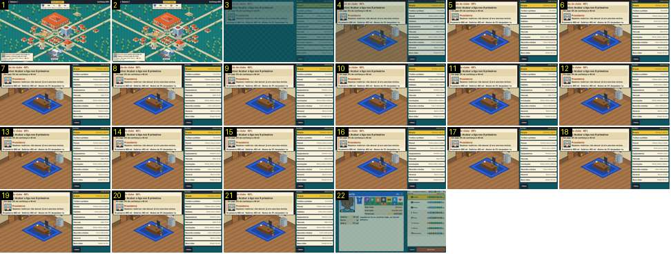

# Da cidade ao escritório e do escritório ao mercado

O treinador toca no «Escritório» do mapa, vê o escritório (a sala isométrica com a secretária e a lista de opções) e entra no «Mercado». Mostra que a cena desenhada chega um frame depois do painel. Compara-se com a entrada no escritório do Calciobit, onde as colunas de botões redondos entram a rolar ([apoio-adeptos-e-entrar-escritorio](../../../../calciobit/sequencias/menus-transicoes/apoio-adeptos-e-entrar-escritorio/README.md)).

- **Duração:** 2,2 s, 22 frames a 10 fps
- **Origem:** `npm run sequences` (commit 2de1e62), vídeo `menus.mp4`, de 21,4 s a 23,6 s
- **Etiquetas:** cidade, escritorio, mercado, cortina, fade-sem-preto, cena-atrasada, presidente
- **Calciobit:** [apoio-adeptos-e-entrar-escritorio](../../../../calciobit/sequencias/menus-transicoes/apoio-adeptos-e-entrar-escritorio/README.md), [escritorio-cidade-treino](../../../../calciobit/sequencias/menus-transicoes/escritorio-cidade-treino/README.md)

## Frame a frame

- **1–2:** o mapa da cidade. O toque no «Escritório» não acende o edifício.
- **3:** corte para o escritório, escurecido (cerca de 60 % do brilho final). Só está o painel: à esquerda «Direção do clube · 60%», o objetivo («Acabar a liga nos 9 primeiros»), o presidente com retrato e fala, e o orçamento; à direita a lista «Direção, Troféus e prémios, Plantel, Emblema, Equipamentos, Mercado, Instalações, Recordes e lendas, Historial, Novo clube» e «‹ Voltar». Onde vai a sala vê-se só o fundo escuro aos quadrados.
- **4:** a sala isométrica aparece de uma vez (soalho de madeira, tapete azul, secretária, computador, arquivo), e tudo acende até cerca de 90 %.
- **5:** cheio. A lista e o painel do presidente não entram com movimento: estão no sítio desde o 3.
- **6–21:** parado. A fala do presidente («Sejamos realistas: não descer já era uma boa notícia.») está inteira desde o primeiro frame.
- **22:** o toque em «Mercado»: corte para o mercado, já com a ficha do primeiro jogador livre à esquerda e a lista à direita, a cerca de 90 % e a acender. Fica cheio 0,1 s depois (fora da sequência).

Ritmo: cada mudança tem 0,15–0,2 s de fade de entrada, sem escurecer o ecrã de saída e sem preto. A sala só é desenhada na imagem seguinte ao corte, por isso o primeiro frame mostra um buraco onde ela vai estar. O mesmo acontece com o mapa ao sair do «criar clube» (vídeo `menus.mp4`, 5,76 s) e com o balneário ([cidade-para-pavilhao](../cidade-para-pavilhao/README.md)).
