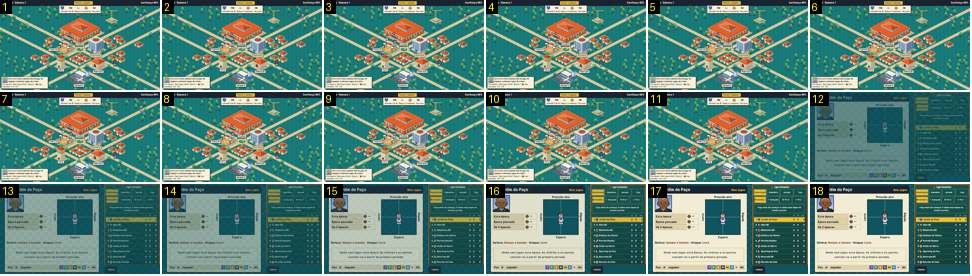

# Da cidade à federação

O treinador toca na «Federação» do mapa e abre o ecrã da liga: a ficha do clube à esquerda e a classificação da «Liga Iniciados» à direita. É o par direto de [cidade-entrar-federacao](../../../../calciobit/sequencias/menus-transicoes/cidade-entrar-federacao/README.md), onde o Calciobit passa pelo preto em 0,6–0,7 s e o botão de voltar entra a rodar.

- **Duração:** 0,6 s, 18 frames a 30 fps
- **Origem:** `npm run sequences` (commit 2de1e62), vídeo `menus.mp4`, de 31,55 s a 32,15 s
- **Etiquetas:** cidade, federacao, liga, classificacao, cortina, fade-sem-preto, separadores
- **Calciobit:** [cidade-entrar-federacao](../../../../calciobit/sequencias/menus-transicoes/cidade-entrar-federacao/README.md)

## Frame a frame

- **1–11:** o mapa parado, com os bonecos a andar. O toque na «Federação» não acende o edifício.
- **12:** corte para a federação, a cerca de 65 % do brilho final, sobre o fundo escuro aos quadrados. Já estão todos os elementos: à esquerda «Jardim do Paço · Sem jogos», o retrato do treinador, «Esta época / Época passada / Há 2 épocas», o quadro de estilo de jogo («Pressão alta», «Rápido», «Espera», «Lento») e «Defesa: Homem a homem · Ataque: Livre»; à direita os separadores «Classificação, Calendário, Jornada, Taça» e «Iniciados, Avançada, Pro 2, Pro 1» (o escolhido a dourado), a tabela de dez clubes com o nosso a amarelo e «‹ Voltar».
- **13–17:** acende até cheio, em 0,15 s.
- **18:** parado.

Ritmo: 0,15–0,2 s de fade de entrada, sem preto. O botão de voltar é um botão retangular na barra de baixo e não tem entrada própria. Trocar de separador não foi gravado.
