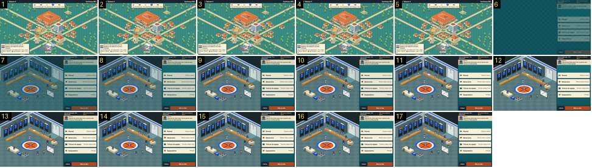

# Da cidade ao pavilhão, em semana de jogo

Na semana de um jogo da taça, o treinador toca no «Pavilhão» do mapa e entra no balneário, onde se prepara o jogo («Plantel», «Adversário», «Táticas da equipa», «Equipamento» e «Bola ao alto»). No Calciobit esta passagem começa com o adjunto a perguntar se vamos para o estádio e passa pelo preto em cerca de 2 s ([mapa-para-tunel-live](../../../../calciobit/sequencias/entrada-saida/mapa-para-tunel-live/README.md)).

- **Duração:** 0,6 s, 17 frames a 30 fps
- **Origem:** `npm run sequences` (commit 2de1e62), vídeo `menus.mp4`, de 36,25 s a 36,85 s
- **Etiquetas:** cidade, pavilhao, balneario, pre-jogo, cortina, fade-sem-preto, cena-atrasada, adjunto
- **Calciobit:** [mapa-para-tunel-live](../../../../calciobit/sequencias/entrada-saida/mapa-para-tunel-live/README.md), [cidade-avancar-semana](../../../../calciobit/sequencias/menus-transicoes/cidade-avancar-semana/README.md)

A semana de jogo foi alcançada a saltar semanas por código (`fastForward`), por isso não se vê o «Passar a semana».

## Frame a frame

- **1–5:** o mapa em semana de jogo («Setembro · Semana 4», «Confiança 58%»). O cartão de cima mostra o jogo: «Taça da Federação · Pré-eliminatória · Esta semana · Fora». A secretária fala das cartas. O pavilhão não tem bandeiras nem outro sinal de dia de jogo além do cartão. O toque no «Pavilhão» não acende o edifício, e ninguém pergunta se queremos ir.
- **6:** corte para o balneário, muito escuro (cerca de 55 % do brilho final). Só está o painel da direita: «Taça da Federação · Pré-eliminatória», «PAC contra União da Serra», o adjunto com retrato e a fala inteira («Jogo partido. Ganha quem tiver as pernas mais frescas no último período.»), os quatro botões e «Bola ao alto». A cena do balneário ainda não foi desenhada: o lado esquerdo é só o fundo escuro.
- **7:** o balneário isométrico aparece de uma vez (cacifos, bancos, o centro do campo pintado no chão, o quadro tático, bonecos de equipamento azul), ainda escurecido.
- **8–9:** acende até cheio (0,15 s do 6 ao 9).
- **10–17:** parado, com os bonecos do balneário a mexer-se devagar.

Ritmo: 0,15–0,2 s de fade de entrada, sem preto e sem pergunta. A fala do adjunto não se escreve letra a letra.
