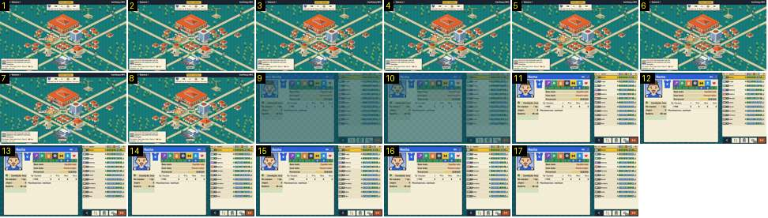

# Da cidade ao treino

O treinador toca no «Treino» do mapa e abre o ecrã de treino: a ficha do jogador à esquerda e a lista do plantel à direita. É a passagem que o Calciobit faz pelo preto em 0,6–0,8 s, com o edifício a acender-se e os botões laterais a rolar ([escritorio-cidade-treino](../../../../calciobit/sequencias/menus-transicoes/escritorio-cidade-treino/README.md)).

- **Duração:** 0,6 s, 17 frames a 30 fps
- **Origem:** `npm run sequences` (commit 2de1e62), vídeo `menus.mp4`, de 8,75 s a 9,3 s
- **Etiquetas:** cidade, treino, cortina, fade-sem-preto, ficha-jogador
- **Calciobit:** [escritorio-cidade-treino](../../../../calciobit/sequencias/menus-transicoes/escritorio-cidade-treino/README.md)

## Frame a frame

- **1–8:** o mapa da cidade («Setembro · Semana 1»), com o cartão do jogo seguinte em cima ao centro, a secretária num balão em baixo à esquerda e bonecos a andar nas ruas. O toque na etiqueta «Treino (3)» não acende o edifício nem a etiqueta: o mapa fica igual até ao corte.
- **9–10:** corte para o ecrã do treino a cerca de metade do brilho, sobre o fundo escuro aos quadrados. Já estão lá a ficha de «Rocha» (retrato, sete atributos com nota, «Sem bola / Com bola / Potencial», condição, salário), a lista do plantel com «Rocha» destacado a amarelo, e a barra de botões em baixo à direita.
- **11:** cheio. O fade durou cerca de 0,1 s (3 frames).
- **12–17:** parado. Nenhum botão entra depois do fade: a barra de baixo e a lista já estavam no sítio.

Ritmo: 0,1–0,2 s de fade de entrada, sem escurecer o mapa e sem preto. O ecrã de treino não tem cena: não há jogadores de pé no campo, só a ficha e a lista.
