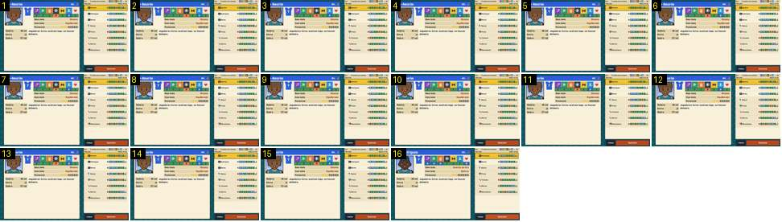

# Mercado: abrir um jogador e contratar

No mercado, o treinador toca no primeiro jogador livre («Amorim») e depois em «Contratar». Mostra o que o jogo faz quando se assina um contrato. No Calciobit a secretária confirma, pergunta sim/não e passa a palavra ao adjunto, tudo com fades ([mercado-resposta-secretaria](../../../../calciobit/sequencias/menus-transicoes/mercado-resposta-secretaria/README.md)).

- **Duração:** 1,6 s, 16 frames a 10 fps
- **Origem:** `npm run sequences` (commit 2de1e62), vídeo `menus.mp4`, de 24,9 s a 26,6 s
- **Etiquetas:** mercado, ficha-jogador, contratar, sem-confirmacao, orcamento
- **Calciobit:** [mercado-resposta-secretaria](../../../../calciobit/sequencias/menus-transicoes/mercado-resposta-secretaria/README.md), [ficha-jogador-fechar-abrir](../../../../calciobit/sequencias/menus-transicoes/ficha-jogador-fechar-abrir/README.md)

## Frame a frame

- **1:** o toque em «Amorim», que já estava escolhido. A ficha à esquerda é dele («Livre», retrato, sete atributos, «Sem bola: Dínamo», «Com bola: Equilibrado», salário 45 mil, «Entra: já», «Sobra 117 mil») e a linha dele está destacada a amarelo na lista. Nada muda no ecrã.
- **2–15:** parado. A ficha não tem entrada nem saída: está sempre no mesmo sítio, num painel fixo, e não há ecrã por trás a desfocar.
- **16:** o toque em «Contratar». Num só frame:
  - a linha de «Amorim» desaparece e a lista sobe uma linha;
  - «Rodrigues» passa a estar destacado e a ficha mostra-o a ele (salário 38 mil, «Sobra 72 mil»);
  - em cima à direita, «Sobra 117 mil» passa a «Sobra 72 mil».
- **Depois (até 28,5 s, fora da sequência):** nada mais. Não há mensagem, diálogo nem animação do jogador a entrar no plantel.

Para quem joga, a única prova de que a contratação correu bem é a linha que desaparece e o dinheiro que baixa.
