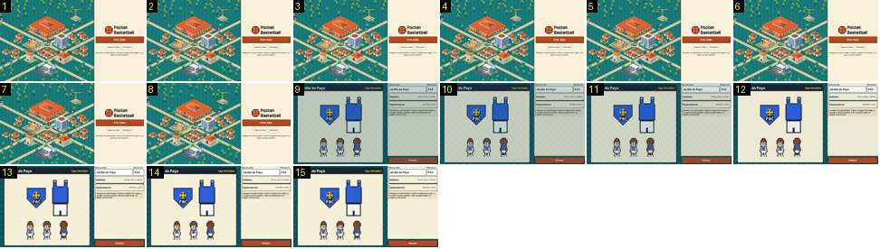

# Do ecrã-título ao «criar clube»

O treinador carrega em «Criar clube» no ecrã-título e abre o formulário do clube novo. Mostra a única cortina que o Pocket Basketball usa entre ecrãs: o ecrã novo aparece já meio aceso sobre o fundo escuro e acende em menos de 0,2 s, sem passar por preto. Compara-se com o ritmo de [escritorio-cidade-treino](../../../../calciobit/sequencias/menus-transicoes/escritorio-cidade-treino/README.md).

- **Duração:** 0,5 s, 15 frames a 30 fps
- **Origem:** `npm run sequences` (commit 2de1e62), vídeo `menus.mp4`, de 3,95 s a 4,45 s
- **Etiquetas:** titulo, criar-clube, cortina, fade-sem-preto, botao-premido
- **Calciobit:** [escritorio-cidade-treino](../../../../calciobit/sequencias/menus-transicoes/escritorio-cidade-treino/README.md)

A gravação só guarda imagens quando o ecrã muda (no máximo 25 por segundo). A 30 fps há frames repetidos, e um troço parado pode aparecer como um salto.

## Frame a frame

- **1–8:** o ecrã-título: à esquerda a cidade isométrica com bonecos a andar, à direita o painel creme com o logótipo «Pocket Basketball», o botão laranja «Criar clube» e os botões «Importar clube» e «Definições». O toque em «Criar clube» acontece nestes frames e não se vê nenhuma resposta: o botão não muda de cor nem de tamanho.
- **8–9:** o título não escurece. Passa-se num corte para o ecrã novo, já com cerca de 80 % do brilho final, sobre o fundo escuro aos quadrados: o emblema «PAC», o equipamento azul, três bonecos e, à direita, o nome «Jardim do Paço», a abreviatura, «Emblema», «Equipamentos» e o botão «Começar».
- **9–12:** o ecrã acende até ficar cheio (0,1 s), mais depressa no início do que no fim. Nada desliza nem muda de escala.
- **13–15:** parado.

Ritmo: não há escurecer nem preto. Do toque ao ecrã novo cheio vão cerca de 0,3 s, dos quais 0,1–0,2 s de fade de entrada (`stage-in` em `src/ui/style.css`: opacidade de 0,35 a 1 em 0,18 s, `ease-out`).
