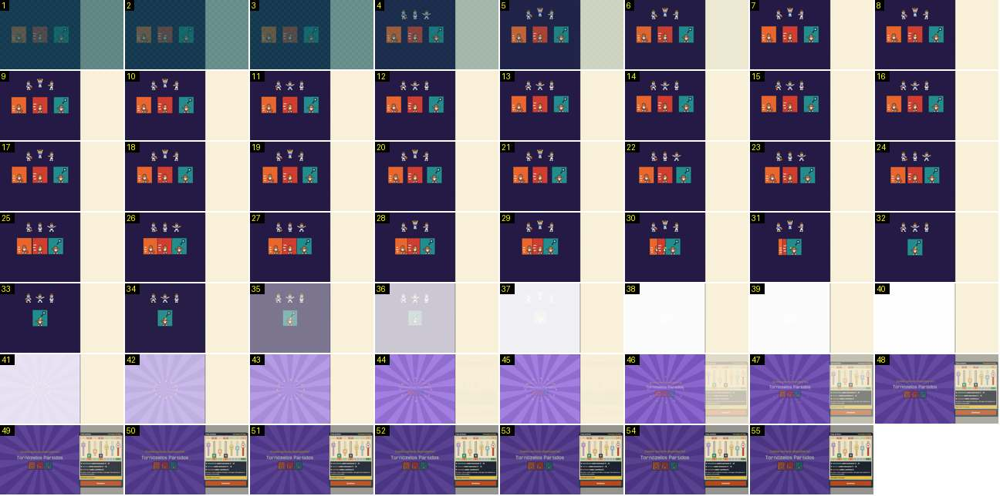

# Treino: três cartas fazem um combo secreto

O treinador carrega em «Treinar» com «Drible», «Sprints» e «Ler a Defesa», que formam o combo secreto «Tornozelos Partidos». As cartas juntam-se ao centro, um clarão branco revela um fundo de raios roxos com o nome do combo e o painel do resultado acende à direita. É o par da cerimónia do «SPECIAL MENU» do Calciobit, que dura cerca de 9 s; aqui são 1,8 s.

- **Duração:** 1,8 s, 55 frames a 30 fps
- **Origem:** `npm run sequences` (commit 2de1e62), vídeo `menus.mp4`, de 13,95 s a 15,95 s (a gravação só tem imagens a partir de 14,12 s)
- **Etiquetas:** treino, cartas, combo, clarao, raios, faiscas, recompensa, cortina
- **Calciobit:** [treino-combo-cartas-special-menu](../../../../calciobit/sequencias/menus-transicoes/treino-combo-cartas-special-menu/README.md), [treino-special-menu-descoberto](../../../../calciobit/sequencias/menus-transicoes/treino-special-menu-descoberto/README.md)

## Frame a frame

- **1–6:** a cortina de mudança de ecrã: a cena do combo aparece a cerca de 35 % sobre o fundo escuro e acende em 0,2 s. A cena ocupa a área do campo (à esquerda) e tem fundo roxo-escuro liso. O painel da direita fica creme e vazio.
- **4–34:** em cima, três bonequinhos de equipamento azul (o jogador que treina, um por carta) fazem poses de treino em ciclo, umas 5 por segundo: driblar, braços no ar, passar.
- **7–14:** por baixo, as três cartas («Drible» laranja, «Sprints» vermelha, «Ler a Defesa» verde-azulada) estão lado a lado, sem moldura de combo. Sobem cerca de 8 px, devagar.
- **15–34:** as cartas deslizam para o centro, cada vez mais depressa, e sobrepõem-se: no 30 as duas da esquerda já estão meio tapadas pela da direita, e no 32–34 só se vê uma carta ao centro. Não giram, não encolhem e não viram bolas de luz.
- **35–38:** clarão branco: o ecrã inteiro da cena fica branco em 0,1 s (a cerca de 50 % no 35, quase branco no 37). O painel da direita não é tocado pelo clarão.
- **39–44:** o branco desvanece em 0,2 s e revela um fundo de raios roxos alternados, claros e escuros, a partir do centro. Doze faíscas douradas quadradas formam um anel ao centro e afastam-se, a apagar.
- **44–48:** o texto cresce de cerca de 60 % até ao tamanho final, com fade, em 0,3 s: «Combo secreto descoberto!» em dourado, «Tornozelos Partidos» em letra grande clara, e as três cartas pequenas por baixo.
- **45–50:** o painel da direita acende num fade de 0,2 s: «Treino de Rocha / Tornozelos Partidos», sete barras de atributos, as frases «A velocidade subiu bastante: C → B», «A técnica subiu bastante: C → B», «A vontade subiu: continua C», a faixa dourada «Aprendeu Crossover» e o botão «Continuar».
- **48–55:** quando o painel aparece, a cena do combo fica esbatida, como atrás de um véu: os raios perdem cor e o título perde contraste. Os raios rodam muito devagar (uma volta em 14 s).
- **Depois (16,1 s em diante, fora da sequência):** as barras do painel sobem até à nota nova, durante cerca de 1,1 s.

Comparação de ritmo: o Calciobit mostra as cartas uma a uma, gira-as, transforma-as em bolas de luz que pulsam três vezes, apaga-as uma a uma, e só então vem o clarão (cerca de 9 s). O Pocket Basketball mostra as três de uma vez e chega ao clarão em 1,1 s.
