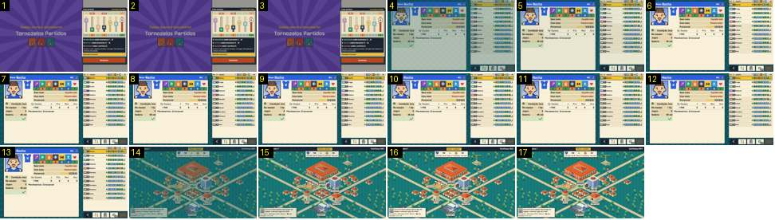

# Do resultado do treino de volta à cidade

O treinador carrega em «Continuar» no resultado do combo, volta à lista do treino e sai para a cidade (no vídeo, com a tecla Esc, que faz o mesmo que «Voltar»). É o par do regresso ao mapa do Calciobit, onde o cartão do próximo jogo entra com um ressalto ([regresso-cidade-proximo-jogo](../../../../calciobit/sequencias/menus-transicoes/regresso-cidade-proximo-jogo/README.md)).

- **Duração:** 1,7 s, 17 frames a 10 fps
- **Origem:** `npm run sequences` (commit 2de1e62), vídeo `menus.mp4`, de 17,9 s a 19,6 s
- **Etiquetas:** treino, cidade, cortina, fade-sem-preto, proximo-jogo, secretaria
- **Calciobit:** [regresso-cidade-proximo-jogo](../../../../calciobit/sequencias/menus-transicoes/regresso-cidade-proximo-jogo/README.md)

## Frame a frame

- **1–3:** o resultado do combo parado (raios roxos à esquerda, painel do treino à direita).
- **4–5:** corte para a lista do treino a cerca de 75 % sobre o fundo escuro e fade até cheio em 0,1–0,2 s. A ficha de «Rocha» já mostra «Movimentos: Crossover» e um visto verde na linha de baixo. A cena do combo não sai: desaparece no corte.
- **6–13:** a lista do treino parada.
- **14:** corte para a cidade, ainda escurecida (cerca de 80 % do brilho final). Já estão todos os elementos: a data «Setembro · Semana 1» em cima à esquerda, «Passar a semana» ao centro, «Confiança 60%» à direita, o cartão do jogo seguinte («PAC vs CNI · Jornada 1 de 18 · Daqui a 2 semanas · Em casa»), as etiquetas dos edifícios, a secretária com a sua fala em baixo à esquerda e a linha da época.
- **15–16:** a cidade acende até cheia (0,2 s).
- **16–17:** parado. O cartão do jogo seguinte não tem animação própria: aparece com o resto, no mesmo fade. A fala da secretária («Esta semana não há jogo. Há equipas a oferecer jogos de treino.») já está inteira desde o primeiro frame.

Ritmo: duas mudanças de ecrã seguidas, cada uma com 0,15–0,2 s de fade de entrada e sem preto. Os bonecos da cidade continuam a andar logo no primeiro frame.
