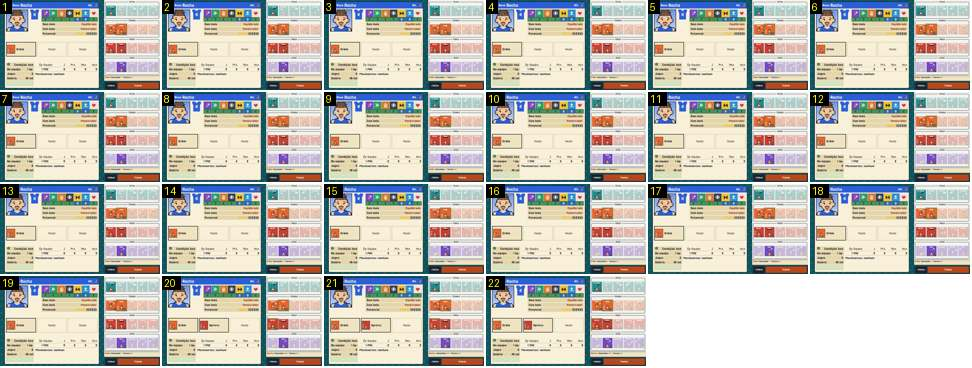

# Treino: escolher cartas

Com as gavetas de cartas abertas (Tática, Técnica, Físico e Apoio), o treinador toca em «Sprints» depois de já ter posto «Drible». Mostra a resposta ao toque numa carta. Compara-se com o botão que fica amarelo durante um frame no Calciobit ([ficha-jogador-fechar-abrir](../../../../calciobit/sequencias/menus-transicoes/ficha-jogador-fechar-abrir/README.md), frame 11).

- **Duração:** 0,7 s, 22 frames a 30 fps
- **Origem:** `npm run sequences` (commit 2de1e62), vídeo `menus.mp4`, de 12,17 s a 12,92 s
- **Etiquetas:** treino, cartas, botao-premido, gavetas, ranhuras
- **Calciobit:** [ficha-jogador-fechar-abrir](../../../../calciobit/sequencias/menus-transicoes/ficha-jogador-fechar-abrir/README.md), [mercado-resposta-secretaria](../../../../calciobit/sequencias/menus-transicoes/mercado-resposta-secretaria/README.md)

## Frame a frame

- **1–19:** a ficha de «Rocha» com três ranhuras por baixo: «Drible» na primeira, «Vazio» nas outras duas. À direita, as quatro gavetas de cartas: as que há em stock em cor cheia, com «x1» ou «x2»; as que faltam desbotadas, com «x0». A carta «Drible» na gaveta tem uma moldura dourada e preta e passou a «x0». Na linha de baixo lê-se «Drible. Velocidade + · Técnica ++».
- **20:** o toque em «Sprints». Num só frame, sem nenhum frame intermédio:
  - a carta «Sprints» da gaveta ganha a moldura dourada e passa de «x1» a «x0»;
  - a segunda ranhura passa de «Vazio» a «Sprints», com a imagem da carta;
  - a linha de baixo muda para «Sprints. Velocidade +++ · Técnica ++».
- **21–22:** parado. A moldura dourada fica: não é um brilho de um frame, é a marca de carta escolhida.

O mesmo acontece no terceiro toque («Ler a Defesa», em 13,48 s no vídeo). Não há flash amarelo, nem salto, nem a carta a voar da gaveta para a ranhura. O código tem um «afundar» de 1 px enquanto o dedo está em cima (`button:active` em `src/ui/style.css`), que um clique automático não chega a mostrar.
